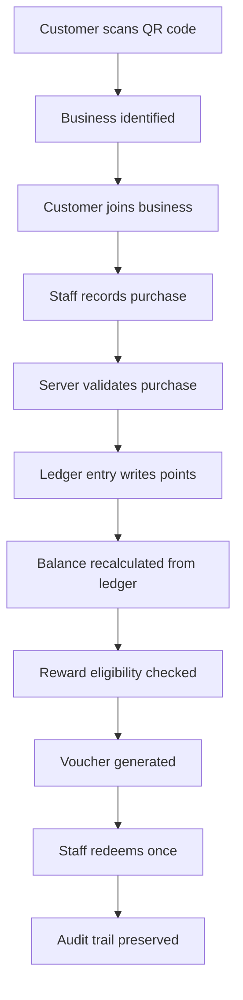

# Repeato

<div align="center">
  
  
  
  
  
</div>

<p align="center">
  <strong>Modern loyalty + retention software for cafés, restaurants, and hospitality brands.</strong>
</p>

<p align="center">
  Repeato helps businesses grow repeat visits with QR member onboarding, verified in-person purchases, reward vouchers, and secure ledger-based point accounting.
</p>

<div align="center">
  <a href="#quick-start">Get started</a>
  ·
  <a href="#features">Features</a>
  ·
  <a href="#architecture">Architecture</a>
  ·
  <a href="#docs">Docs</a>
</div>

---

## Why teams choose Repeato

Repeato is built for businesses that need loyalty to feel operationally real — not just a frontend gimmick.

A customer joins a business by scanning a QR code, earns points only when staff record a verified purchase, and can redeem one-time rewards at the counter. The experience is simple for the customer, but the platform is designed around secure, auditable rules behind the scenes.

The product rule that shapes everything:

> A QR scan never awards points.

Scanning only identifies the business. Points are written by the server, in a transaction, after a valid purchase event.

---

## Feature highlights

<div align="center">
  <table>
    <tr>
      <td align="center" valign="top" width="33%">
        <strong>QR onboarding</strong><br /><br />
        Customers join a business in seconds from a QR code or join link.
      </td>
      <td align="center" valign="top" width="33%">
        <strong>Verified purchases</strong><br /><br />
        Staff record actual purchases and the server validates them before points are issued.
      </td>
      <td align="center" valign="top" width="33%">
        <strong>One-time rewards</strong><br /><br />
        Rewards convert into vouchers that can only be redeemed once and are tracked securely.
      </td>
    </tr>
    <tr>
      <td align="center" valign="top" width="33%">
        <strong>Ledger-based balance</strong><br /><br />
        Balances are derived from trusted ledger entries instead of mutable point counters.
      </td>
      <td align="center" valign="top" width="33%">
        <strong>Multi-tenant safety</strong><br /><br />
        Every business is isolated and access is checked on the server before sensitive actions run.
      </td>
      <td align="center" valign="top" width="33%">
        <strong>Audit-friendly history</strong><br /><br />
        Reversals, purchases, and redemptions remain visible and explainable in the system.
      </td>
    </tr>
  </table>
</div>

---

## How it works



### Core flow

1. A customer scans a QR code for a business.
2. The app identifies the business and confirms membership.
3. Staff record a real purchase.
4. The server validates the purchase and writes a ledger entry.
5. The customer balance is recalculated from trusted records.
6. Rewards become one-time vouchers eligible for redemption.
7. Reversals and voucher status changes remain in the system history.

This keeps the platform safer than simple browser-trusted point updates.

---

## Product experience

### Customer app

- join via QR code or join link
- wallet and points history
- reward discovery and redemption
- loyalty tier progression
- purchase and activity timeline

### Business console

- transactions and customer records
- reward management
- QR configuration
- analytics and reporting
- team access and settings

### Admin console

- businesses overview
- user management
- audit log access
- platform operations

---

## Architecture

### Frontend

- Next.js 16 with App Router
- React 19
- TypeScript
- Tailwind CSS
- modern admin and customer UX

### Backend

- server-side mutations and validation
- secure business logic in trusted service layers
- role-based authorization and tenant checks

### Data layer

- SQLite for local development
- PostgreSQL for production-like and CI environments
- single abstraction layer across both database backends

```text
app/            UI routes and pages
components/     reusable UI pieces
lib/            auth, services, validation, points, db, csv
scripts/        local db and migration helpers
test/           unit, integration, and RLS tests
docs/           product and engineering documentation
```

---

## Security-first by design

Repeato is designed around server-side authority.

- browser data is not trusted for balance updates
- membership is validated before rewards or points are granted
- duplicate actions are blocked using idempotency checks
- tenant isolation prevents cross-business leaks
- reversals are represented as compensating ledger rows, not destructive deletes
- audit history stays intact for operational clarity and compliance readiness

---

## Loyalty tiers

Repeato includes tier-based progression such as:

- Bronze
- Silver
- Gold
- Platinum

Each tier can include:

- spend thresholds
- point thresholds
- discounts
- multiplier bonuses
- upgrade progress math and reward logic

---

## Stack

- Next.js 16
- React 19
- TypeScript
- Tailwind CSS
- SQLite
- PostgreSQL
- Vitest
- Playwright
- Recharts

---

## Quick start

### Prerequisites

- Node.js 22+
- npm

### Install

```bash
git clone https://github.com/Bhishamt/Repeato.git
cd Repeato
npm install
```

### Setup environment

```bash
cp .env.example .env.local
```

### Seed demo data

```bash
npm run seed
```

### Run locally

```bash
npm run dev
```

Open:

```text
http://localhost:3000
```

---

## Demo accounts

Demo users are seeded for local exploration.

Default password is read from `DEMO_PASSWORD` and commonly defaults to:

```text
Repeato!2026
```

Examples:

- Admin: `admin@repeato.local`
- Business owner: `priya@bluebird.test`
- Business staff: `arun@bluebird.test`
- Business owner: `daniel@urbanbrew.test`
- Customers: `asha@example.test`, `ravi@example.test`, `meera@example.test`

Join links:

- `/join/bluebird-coffee`
- `/join/urban-brew-cafe`

---

## Scripts

```bash
npm run dev
npm run build
npm start
npm test
npm run typecheck
npm run seed
npx playwright test
```

---

## Environment

The app reads configuration from `.env.local`, including values such as:

- `DATABASE_URL`
- `DATABASE_PATH`
- `APP_URL`
- `ADMIN_EMAIL`
- `ADMIN_PASSWORD`
- `DEMO_PASSWORD`
- `PG_TEST_URL`

---

## Repository docs

- `docs/PRODUCT_REQUIREMENTS.md`
- `docs/ARCHITECTURE.md`
- `docs/DATABASE_SCHEMA.md`
- `docs/SECURITY.md`
- `docs/TESTING.md`
- `docs/DEPLOYMENT.md`
- `docs/KNOWN_LIMITATIONS.md`

---

## Why this project matters

Repeato is not just a point-tracking app. It models a real operational flow for hospitality loyalty:

- join once
- purchase verification
- secure points issuance
- reward conversion
- controlled redemption
- traceable, ledger-based accounting

It is built to feel modern, trustworthy, and production-aware while remaining easy to run locally.

---

## Summary

Repeato gives businesses a clean, modern way to manage loyalty without sacrificing security or operational integrity. It blends a polished customer experience with backend controls that keep point accrual honest and reward redemption reliable.

Built for trust. Designed for retention. Ready for real hospitality workflows.
