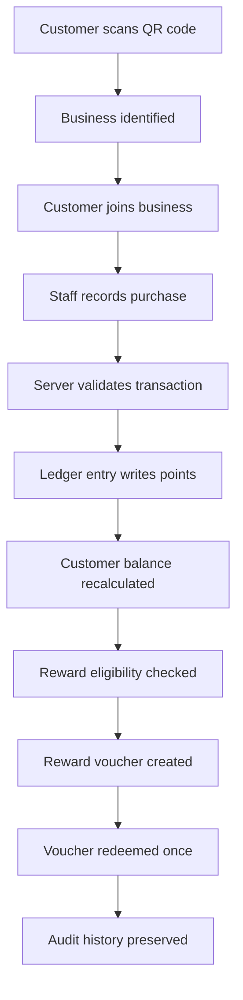

# Repeato

Modern loyalty and retention software for cafés and restaurants.

Repeato helps businesses turn casual visitors into repeat customers with QR-based membership, staff-verified purchases, and secure reward redemption.

The core rule is simple: a QR scan never awards points. Scanning identifies the business. Points are written only by the server after a valid staff-recorded sale.

<div align="center">
  <table>
    <tr>
      <td align="center"><strong>QR Membership</strong><br/>Fast sign-up from a business QR code.</td>
      <td align="center"><strong>Verified Purchases</strong><br/>Staff record real transactions and the server writes points.</td>
      <td align="center"><strong>One-Time Rewards</strong><br/>Points convert into vouchers that cannot be reused.</td>
    </tr>
    <tr>
      <td align="center"><strong>Ledger-Based Balances</strong><br/>Balances are derived from trusted ledger entries, not mutable counters.</td>
      <td align="center"><strong>Role Controls</strong><br/>Separate access for admin, owner, staff, and customer.</td>
      <td align="center"><strong>Audit Trail</strong><br/>Every purchase, reversal, and redemption remains traceable.</td>
    </tr>
  </table>
</div>

## What Repeato is

Repeato is a multi-tenant loyalty platform designed for businesses that need a practical, auditable way to reward repeat customers without trusting browser-side data.

It is built for:

- cafés and coffee shops
- restaurants and quick-service counters
- hospitality businesses with in-person sales
- loyalty programs that require secure, traceable point issuance

## What it does

### Customer experience

- join from a QR code or dedicated join link
- see membership status and wallet activity
- view points, rewards, and redemption progress
- redeem valid vouchers at the counter
- track loyalty progression over time

### Staff workflow

- record purchases for members
- validate the transaction amount
- trigger points issuance in a server-side transaction
- redeem one-time vouchers for customers
- inspect current customer and business history

### Business owner workflow

- define business rules and rewards
- manage customer engagement and transactions
- view analytics on loyalty growth
- monitor redemption and reward usage
- control staff access and settings

### Admin workflow

- manage multiple businesses
- review onboarding and user access
- inspect audit logs and operational data
- monitor platform-level activity and governance

## How it works

1. A customer scans a QR code for a business.
2. The app identifies the business and confirms membership.
3. A staff member records a purchase.
4. The server validates the transaction and writes a ledger entry.
5. The customer balance is recalculated from trusted records.
6. Eligible rewards become vouchers.
7. Staff redeem vouchers once and the voucher is marked as used.
8. Reversals are tracked instead of silently deleted.

This creates a trustworthy system for real-world loyalty operations.

## Why the QR rule matters

The most important product rule is:

> A QR scan never awards points.

This protects the business from fake point issuance and browser-side manipulation. The browser can identify a business, but only the server can authorize balance changes.

## Architecture overview

### Frontend

- Next.js App Router
- React 19
- TypeScript
- Tailwind CSS

### Backend and business logic

- authenticated access control
- membership validation
- purchase verification
- points and reward logic
- redemption rules
- tenant isolation

### Data layer

- SQLite for local development
- PostgreSQL for production-like environments
- single abstraction layer across both backends

## Diagram



## Ledger-based model

Repeato avoids the common anti-pattern of storing a single mutable points field that can drift out of sync.

Instead, it records transactions as ledger entries and derives balances from those entries. This gives the platform:

- auditability
- reversibility
- consistency
- lower risk of incorrect balances
- stronger operational trust

## Loyalty tiers

Repeato includes tiered progression logic for customers, including:

- Bronze
- Silver
- Gold
- Platinum

Each tier can be tied to:

- point thresholds
- spend thresholds
- discounts
- multiplier bonuses
- progress tracking toward the next level

## Security model

Repeato is designed around secure server-side authority.

Key principles:

- client-side input is never trusted for balance changes
- role checks are enforced server-side
- membership is validated before point issuance
- duplicate submissions are prevented with idempotency logic
- tenant data stays isolated per business
- reversals and redemptions remain traceable in the audit trail

## Feature cards

<div align="center">
  <table>
    <tr>
      <td align="center"><strong>QR onboarding</strong><br/>Members join once and stay tied to the correct business.</td>
      <td align="center"><strong>Verified sales</strong><br/>A purchase must be valid before points can be issued.</td>
      <td align="center"><strong>Reward vouchers</strong><br/>Rewards become one-time, server-controlled vouchers.</td>
    </tr>
    <tr>
      <td align="center"><strong>Customer wallet</strong><br/>Customers track balances, rewards, and activity history.</td>
      <td align="center"><strong>Business analytics</strong><br/>Owners can monitor engagement and reward performance.</td>
      <td align="center"><strong>Admin controls</strong><br/>Platform admins can manage businesses and audit records.</td>
    </tr>
  </table>
</div>

## Tech stack

- Next.js
- React 19
- TypeScript
- Tailwind CSS
- SQLite
- PostgreSQL
- Vitest
- Playwright
- Recharts

## Quick start

### Install Node.js

Use Node.js 22 or newer.

#### Windows

```powershell
nvm install 22
nvm use 22
```

#### macOS

```bash
brew install node@22
```

or:

```bash
nvm install 22
nvm use 22
```

### Clone and install

```bash
git clone https://github.com/Bhishamt/Repeato.git
cd Repeato
npm install
```

### Configure environment

```bash
cp .env.example .env.local
```

### Seed demo data

```bash
npm run seed
```

### Run the app

```bash
npm run dev
```

Open:

```text
http://localhost:3000
```

## Demo accounts

The seeded data includes demo users for testing.

Default password is read from `DEMO_PASSWORD`, which usually defaults to:

```text
Repeato!2026
```

Examples:

- Admin: `admin@repeato.local`
- Owner: `priya@bluebird.test`
- Staff: `arun@bluebird.test`
- Owner: `daniel@urbanbrew.test`
- Customers: `asha@example.test`, `ravi@example.test`, `meera@example.test`

Demo join links:

- `/join/bluebird-coffee`
- `/join/urban-brew-cafe`

## Useful scripts

```bash
npm run dev
npm run build
npm start
npm test
npm run typecheck
npm run seed
npx playwright test
```

## Environment variables

The app expects values such as:

- `DATABASE_URL`
- `DATABASE_PATH`
- `APP_URL`
- `ADMIN_EMAIL`
- `ADMIN_PASSWORD`
- `DEMO_PASSWORD`
- `PG_TEST_URL`

These are typically configured in `.env.local`.

## Documentation

- `docs/PRODUCT_REQUIREMENTS.md`
- `docs/ARCHITECTURE.md`
- `docs/DATABASE_SCHEMA.md`
- `docs/SECURITY.md`
- `docs/TESTING.md`
- `docs/DEPLOYMENT.md`
- `docs/KNOWN_LIMITATIONS.md`

## Summary

Repeato is a loyalty platform built around real operational logic, not fake browser-only metrics. It combines QR onboarding, verified transactions, secure point issuance, and single-use reward flows into a practical system designed for real hospitality businesses.

It is built to be trustworthy, traceable, and operationally realistic.
